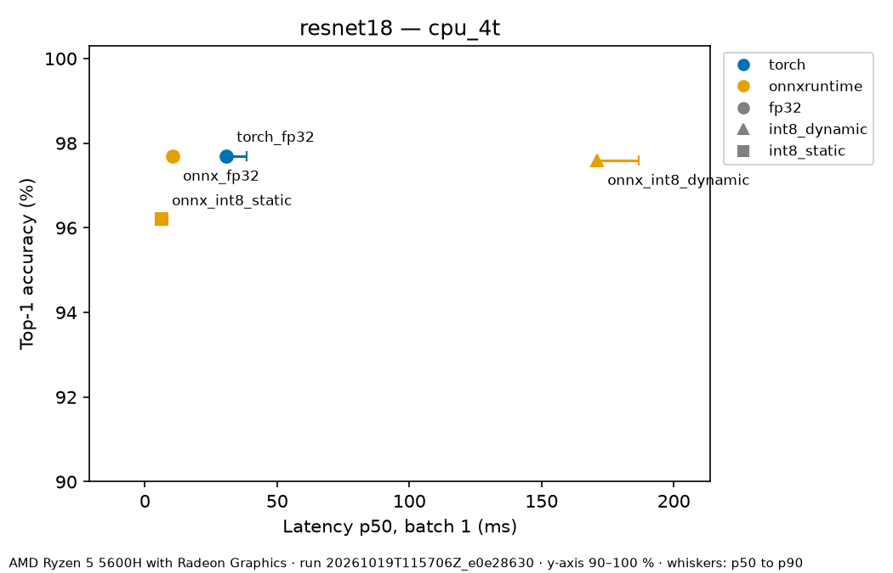
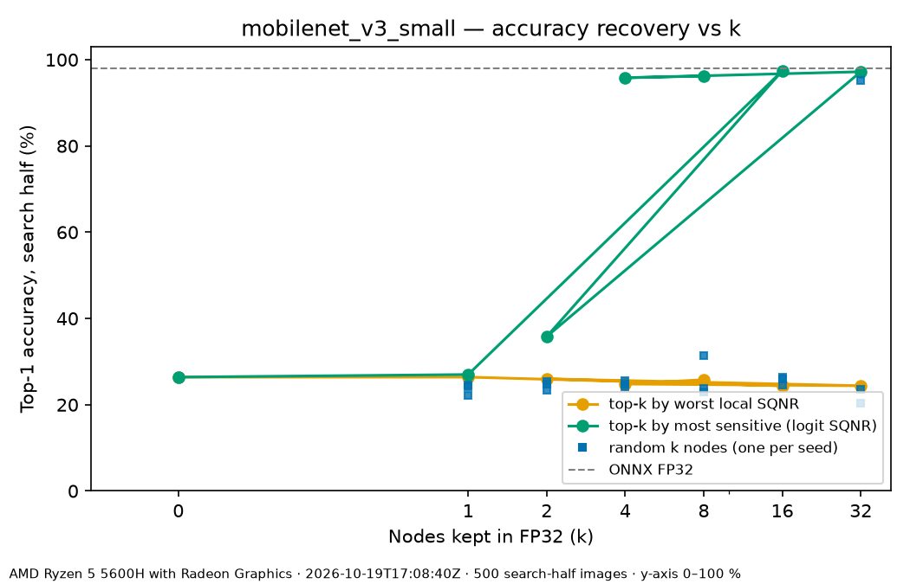

# EdgeBench

A config-driven Python tool that converts PyTorch models to ONNX Runtime (FP32/INT8), checks the converted model's outputs match the original, benchmarks latency/size/accuracy, and fails CI when a conversion regresses.

[](https://github.com/sanyam03-hub/EdgeBench/actions/workflows/ci.yml)

## Why

Deploying a model means converting it into several runtimes and precisions, and those conversions fail silently: export bugs make the converted model drift from the original, INT8 quantization can lose accuracy (sometimes badly), and single-run latency numbers without warmup or fixed threads can't be trusted or reproduced. EdgeBench turns the usual notebook check into one repeatable command: every converted model is compared with the PyTorch reference before any speed number is reported, latency comes with percentiles and spread, and a CI gate fails when accuracy or parity regresses.

## Results

Two torchvision models × four variants, measured with `edgebench run` on the `cpu_4t` profile (4 intra-op threads). Latency is batch 1; CV = std/mean over 200 timed runs, `(noisy)` = CV above 10 %. Top-1 agreement is against the PyTorch FP32 reference on 32 images; Δ is against ONNX FP32.

**ResNet-18** ([full report](results/sample/20261019T115706Z_e0e28630/report.md))

| Variant | Top-1 (%) | Δ (pts) | Agreement | p50 (ms) | p90 (ms) | CV (%) | Size (MB) |
|---|---|---|---|---|---|---|---|
| torch_fp32 | 97.70 | — | — | 30.68 | 38.30 | 21.0 (noisy) | — |
| onnx_fp32 | 97.70 | +0.00 | 1.000 | 10.36 | 12.44 | 12.4 (noisy) | 46.75 |
| onnx_int8_dynamic | 97.60 | −0.10 | 0.969 | 170.93 | 186.69 | 5.8 | 11.74 |
| onnx_int8_static | 96.20 | −1.50 | 1.000 | 6.17 | 7.37 | 9.0 | 11.82 |

**MobileNetV3-Small** ([full report](results/sample/20261019T115339Z_e158a466/report.md))

| Variant | Top-1 (%) | Δ (pts) | Agreement | p50 (ms) | p90 (ms) | CV (%) | Size (MB) |
|---|---|---|---|---|---|---|---|
| torch_fp32 | 97.60 | — | — | 7.54 | 9.54 | 69.2 (noisy) | — |
| onnx_fp32 | 97.60 | +0.00 | 1.000 | 1.35 | 1.79 | 27.3 (noisy) | 10.18 |
| onnx_int8_dynamic | 14.10 | −83.50 | 0.000 (parity FAIL) | 21.14 | 24.40 | 15.7 (noisy) | 2.72 |
| onnx_int8_static | 25.20 | −72.40 | 0.000 (parity FAIL) | 1.74 | 2.20 | 10.9 (noisy) | 2.91 |

Machine: AMD Ryzen 5 5600H (12 logical cores), Windows 10.0.26200 (Windows 11), Python 3.11.4, torch 2.14.1+cpu, onnxruntime 1.31.0, onnx 1.23.2, numpy 2.4.6. Accuracy: 10-way top-1 on 1000 Imagenette `val/` images (see Methodology).



What the numbers show:

- **ONNX FP32 matches PyTorch** (max abs logit error 1.7e-05 for ResNet-18, 6.5e-05 for MobileNetV3-Small; agreement 1.000) and is faster: 2.96× (ResNet-18) and 5.6× (MobileNetV3-Small) at batch 1.
- **ResNet-18 INT8 static is the best trade-off here:** 1.68× faster than ONNX FP32 (10.36 → 6.17 ms), 3.96× smaller, for −1.50 points of top-1.
- **INT8 dynamic is much slower than FP32 on these CNNs** (16.5× for ResNet-18): activations are quantized at run time on every call. It is a poor fit for convolution-heavy models on this CPU, and is reported rather than hidden.
- **MobileNetV3-Small INT8 fails parity** in both modes — the parity check flags it instead of letting a 4× smaller model with near-chance accuracy look like a win. See Limitations.

**Single thread (`cpu_1t`)**, batch 1, p50 / p90 ms, CV:

| Variant | ResNet-18 ([report](results/sample/20261019T142558Z_7b9d053d/report.md)) | MobileNetV3-Small ([report](results/sample/20261019T142240Z_5e1a9353/report.md)) |
|---|---|---|
| torch_fp32 | 58.25 / 67.51, 13.7 % (noisy) | 7.01 / 8.56, 15.1 % (noisy) |
| onnx_fp32 | 36.19 / 41.08, 10.1 % (noisy) | 2.48 / 3.85, 30.5 % (noisy) |
| onnx_int8_dynamic | 552.45 / 561.22, 1.1 % | 32.85 / 40.48, 12.4 % (noisy) |
| onnx_int8_static | 21.21 / 25.97, 16.3 % (noisy) | 3.35 / 4.18, 14.6 % (noisy) |

Accuracy and parity on `cpu_1t` are identical to `cpu_4t` (same model config and seeds; the pipeline is deterministic). Going from 1 to 4 threads speeds up ONNX FP32 3.49× for ResNet-18 (36.19 → 10.36 ms) but only 1.84× for MobileNetV3-Small (2.48 → 1.35 ms), likely because its small layers leave little work to split across threads (not profiled). The INT8 static speedup over FP32 for ResNet-18 holds on one thread (1.71×).

All four runs (results JSON, `report.md`, `pareto.png`) are in [`results/sample/`](results/sample/).

## Per-layer quantization analysis: why MobileNetV3-Small INT8 collapses (stretch S1)

MobileNetV3-Small static INT8 drops to 24 % top-1. [`scripts/s1_layer_error.py`](scripts/s1_layer_error.py) asks which nodes cause it and fixes it by keeping only those in FP32 (mixed precision). Protocol: the 1000 eval images are split (seed 0) into a 500-image **search** half and a 500-image **report** half; both rankings and the choice of k use only the search half; nodes are ranked on 32 search images; every top-k is compared with **k random nodes** (3 seeds), because keeping *any* nodes in FP32 helps a little.

Two rankings of the 127 quantized nodes:

- **Local SQNR** (`20·log10(‖x‖/‖x−x̂‖)`, from ORT's `qdq_loss_debug`): how much each node's weights and inputs lose when quantized. Cheap, one pass.
- **Sensitivity**: quantize *only that node*, keep everything else FP32, and measure the SQNR of the logits against FP32. One quantization per node (127); the whole study took 741 s.

Search half, top-1 when the top-k nodes are kept in FP32 (FP32: 98.00 %, all-INT8: 26.40 %):

| k | Local SQNR ranking | Sensitivity ranking | Random k nodes (3 seeds) |
|---|---|---|---|
| 1 | 26.40 | 27.00 | 24.60, 22.20, 24.20 |
| 2 | 26.00 | 35.80 | 24.80, 23.40, 25.40 |
| 4 | 24.80 | **95.80** | 24.80, 24.20, 25.60 |
| 16 | 24.40 | 97.40 | 26.00, 26.40, 24.60 |
| 32 | 24.40 | 97.20 | 20.40, 23.60, 95.20 |

Report half, with k = 16 chosen on the search half (the smallest k within 1 point of FP32):

| Model | Top-1 (%) | Size (MB) | p50 ms (b=1) | p90 ms (b=1) | CV (%) |
|---|---|---|---|---|---|
| ONNX FP32 | 97.20 | 10.18 | 1.25 | 1.72 | 22.4 (noisy) |
| INT8 static, all nodes | 24.00 | 2.91 | 1.88 | 2.13 | 8.6 |
| INT8, 16 most sensitive nodes in FP32 | **97.00** | 2.93 | 1.60 | 2.02 | 11.5 (noisy) |
| INT8, 16 random nodes in FP32 (3 seeds) | 25.60, 30.60, 24.60 | — | — | — | — |



What it shows:

- **A few early nodes cause the collapse.** The most sensitive are the stem conv (`features.0.0`, logit SQNR −0.1 dB when it alone is INT8), the first conv of block `features.1` (0.1 dB) and the stem HardSwish (0.1 dB). Keeping the top 4 in FP32 recovers 95.8 % on the search half; the top 16 give 97.00 % on the report half at 2.93 MB (vs 2.91 MB all-INT8).
- **Local error does not predict the damage.** Those nodes look healthy locally (weights 44–48 dB, inputs 26–46 dB), and the local-SQNR ranking recovers nothing at any k: small early perturbations are amplified by the rest of the network. The mechanism of that amplification has not been isolated.
- **A measurement trap found on the way:** ORT's `qdq_loss_debug` compares a Conv's raw output with the quantized output of the Relu that the QDQ quantizer folds into it, so the Relu itself shows up as quantization error (median 3.8 dB on Relu outputs vs 40.7 dB against `relu(x)`, 4 images). EdgeBench corrects this; the first, uncorrected ranking recovered nothing either.
- **Control — ResNet-18** (INT8 works): its most sensitive node is also the stem (`conv1`, 10.4 dB), the next ones 28.9 dB and higher; MobileNetV3-Small has three nodes near 0 dB. [ResNet-18 rankings](results/sample/s1/resnet18/report.md).
- The mixed model's latency (1.60 ms) is between all-INT8 (1.88 ms) and FP32 (1.25 ms); INT8 is not faster than FP32 for this small model on this CPU at batch 1.

Full outputs (JSON with every tensor's and node's SQNR, both rankings, plots): [`results/sample/s1/`](results/sample/s1/). Disclosure: the first version of the study (before the Relu correction and the sensitivity ranking) also printed report-half numbers; no choice was tuned on them.

## Architecture

```
configs/<model>.yaml + configs/targets/<target>.yaml
                 │
                 ▼
          config.load_config()  ──► RunConfig (frozen dataclass, validated)
                 │
     ┌───────────┼──────────────────────────────┐
     ▼           ▼                              ▼
 models.py    data.py                     target profile
 (torchvision (Imagenette: calib subset    (threads, batch sizes,
  + weights)   from train, eval subset      warmup, runs)
               from val, shared
               preprocessing)
     │
     ▼
 export.py ──► artifacts/<model>/onnx_fp32.onnx
     │
     ▼
 quantize.py ─► artifacts/<model>/onnx_int8_dynamic.onnx
             └► artifacts/<model>/onnx_int8_static.onnx   (calibrated on calib subset)
                 │  every variant is loaded through the same interface
                 ▼
     backends/registry.py ── create_backend(variant) ──► Backend
          ├─ TorchBackend   (reference)
          └─ OrtBackend     (onnx_*)
                 │
     ┌───────────┼─────────────────┐
     ▼           ▼                 ▼
 parity.py   evaluate.py        bench.py
 (vs torch   (top-1 on eval     (latency stats,
  reference)  subset)            load time, size)
     └───────────┴────────┬────────┘
                          ▼
              env.py (CPU, OS, versions)
                          ▼
           results/<run_id>.json   (schema: docs/Data_Schema.md)
                 │                       │
                 ▼                       ▼
            report.py               gate.py  ◄── baselines/<name>.json
```

- `edgebench run` loads a model config and a target profile, exports ONNX FP32 and quantizes it to INT8 (dynamic, and static QDQ calibrated on `train/` images).
- Every variant is loaded behind one `Backend` interface (`predict(x) -> logits`), so parity, accuracy and timing code never knows which runtime it is measuring.
- Parity against the PyTorch reference runs first; then top-1 accuracy on a fixed `val/` subset; then latency at each batch size.
- Each run writes one versioned JSON file with the config, its hash and the machine environment; `report` and `gate` only read that file, they never re-run a model.
- A failing variant is recorded as `status: error` and the run continues with the next one.

Module responsibilities and command flows are in [docs/Architecture.md](docs/Architecture.md).

## Quickstart

Python 3.11. Bash (Linux / macOS / WSL):

```bash
git clone https://github.com/sanyam03-hub/EdgeBench.git && cd EdgeBench
python3 -m venv .venv && source .venv/bin/activate
pip install torch==2.14.1 torchvision==0.29.1 --index-url https://download.pytorch.org/whl/cpu --extra-index-url https://pypi.org/simple && pip install -e ".[dev]"
mkdir -p data && curl -L https://s3.amazonaws.com/fast-ai-imageclas/imagenette2-160.tgz | tar xz -C data
edgebench run --config configs/mobilenet_v3_small.yaml --target configs/targets/cpu_4t.yaml && edgebench report --results results/*.json
```

Windows PowerShell:

```powershell
git clone https://github.com/sanyam03-hub/EdgeBench.git; cd EdgeBench
py -3.11 -m venv .venv; .\.venv\Scripts\Activate.ps1
pip install torch==2.14.1 torchvision==0.29.1 --index-url https://download.pytorch.org/whl/cpu --extra-index-url https://pypi.org/simple; pip install -e ".[dev]"
mkdir data; curl.exe -L -o data/imagenette2-160.tgz https://s3.amazonaws.com/fast-ai-imageclas/imagenette2-160.tgz; tar -xzf data/imagenette2-160.tgz -C data
edgebench run --config configs/mobilenet_v3_small.yaml --target configs/targets/cpu_4t.yaml; edgebench report --results (Get-ChildItem results\*.json).FullName
```

The run prints a summary table and the path of the results JSON; `report` writes `report.md` and `pareto.png` next to it. Without the dataset, `edgebench run --config configs/smoke_tiny.yaml --target configs/targets/ci.yaml` runs the whole pipeline on a tiny random CNN and synthetic images in under a minute (this is what CI runs). Pretrained weights are downloaded by torchvision on first use.

## Methodology

- **Accuracy:** Imagenette is 10 ImageNet classes. Top-1 is the argmax over those 10 logits of the 1000-class output, on 1000 images sampled (seed 0) from `val/`. It is a 10-way score, not ImageNet top-1, and should not be compared with published ImageNet numbers.
- **Data splits:** INT8 static calibration uses 256 images from `train/` only, so it never sees the evaluation images. Preprocessing is the torchvision weights' own transform, shared by every variant.
- **Parity:** each variant is compared with the PyTorch FP32 logits on the first 32 evaluation images: max/mean absolute error, cosine similarity and top-1 agreement. FP32 tolerance: max abs error ≤ 1e-3, cosine ≥ 0.9999, agreement ≥ 0.99 (observed max abs error was 6.5e-05 and 1.7e-05, so the bound has headroom without hiding real drift). INT8 tolerance: top-1 agreement ≥ 0.90 (INT8 logits legitimately differ, so only decisions are compared).
- **Timing:** `time.perf_counter_ns` around the inference call only (no preprocessing or I/O). 20 warmup runs are discarded, then 200 timed runs. Reported: p50/p90/p99 (linear interpolation), mean, std, IQR and CV = std/mean; a measurement with CV above 10 % is flagged `(noisy)`. Thread counts are fixed per target profile (`cpu_1t`: 1 intra-op thread, `cpu_4t`: 4), for both PyTorch and ONNX Runtime.
- **Environment:** CPU model, OS, Python and library versions are written into every results file; the config hash identifies identical configurations across runs.

## Adding a backend or a target

- **A target** is a YAML file in `configs/targets/` (threads, batch sizes, warmup, runs, noise threshold). No code change.
- **A backend** is a class with `variant`, `runtime`, `precision` and `predict(x: float32 (N,3,H,W)) -> float32 (N,C)` (the `Backend` protocol in `src/edgebench/backends/base.py`). Put it in `src/edgebench/backends/<name>_backend.py`, add its variant to `VARIANT_SPECS` and a lazily-imported factory branch in `backends/registry.py`, and add the variant name to `config.VARIANTS`. Parity, evaluation, benchmarking, reporting and gating then work for it unchanged. Runtimes are imported only when a variant needs them, so an optional backend never breaks installs that don't have it.

## Testing & CI

```bash
pytest                          # fast suite: no network, no dataset
pytest -m "data or slow"        # local only: needs the dataset / pretrained weights
ruff check . && ruff format --check .
```

The fast suite has 205 tests; line coverage is 95 % (`pytest --cov=edgebench`, measured 2026-10-19). The pure-logic modules (`parity`, `bench`, `results`, `gate`) import neither torch nor onnxruntime, which a test enforces.

GitHub Actions (`.github/workflows/ci.yml`) runs ruff, the fast test suite, then a smoke run (`smoke_tiny.yaml`, synthetic data), a report, and the regression gate against [`baselines/ci.json`](baselines/ci.json).

`edgebench gate` checks, per baseline entry: the variant is present, its status is `ok`, top-1 has not dropped more than 0.5 points below the baseline, and parity is within tolerance. Exit code 0 = pass, 1 = regression or failed variant, 2 = config/data/schema error. **Latency is printed but never gated**: shared CI runners vary too much between runs for a latency threshold to mean anything. A deliberately broken baseline was used once to confirm the gate turns CI red (draft PR #1).

## Limitations

- CPU only (PyTorch eager and ONNX Runtime `CPUExecutionProvider`) on one laptop CPU. These are **not** edge, mobile or NPU numbers.
- Latency was measured on a laptop with other software running; several measurements are flagged noisy (CV > 10 %). Compare runs only on the same machine and target profile.
- Accuracy is 10-way top-1 on 1000 Imagenette images, not ImageNet top-1.
- MobileNetV3-Small INT8 collapses to near-chance accuracy with the default ORT settings. For static INT8 the cause is a handful of early nodes and keeping 16 nodes in FP32 restores it (S1 above); the main results table still shows the all-INT8 variants. Dynamic INT8 is not covered by S1 (ORT's debugging tools need a QDQ model), and why those early nodes amplify small errors is not yet explained.
- TFLite is **deferred**: its PyTorch converter (`litert-torch`, formerly `ai-edge-torch`) depends on a package with no Windows build, and this project was developed on native Windows. The TFLite variant names and a lazily-imported backend hook exist, but no TFLite numbers are reported.

## Roadmap (not done)

- **TFLite:** convert on Linux, run with the LiteRT interpreter.
- **S1 follow-ups:** explain why MobileNetV3-Small's early nodes amplify small INT8 errors; extend the analysis to dynamic INT8; offer the mixed-precision model as a regular `edgebench run` variant.
- **S2 — Calibration sweep:** MinMax / Entropy / Percentile × per-tensor / per-channel.
- **S3 — Qualcomm AI Hub:** profile on hosted Snapdragon devices, reported separately and labelled as on-device numbers.
- **S4 — A transformer model** (DistilBERT) to contrast dynamic quantization.
- **S5 — Dockerfile and a GitLab CI mirror.**
